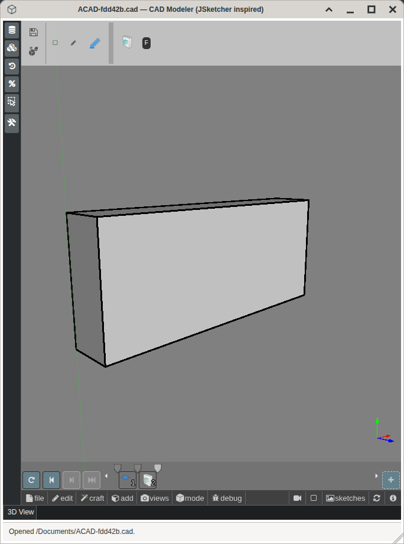

# CAD Modeler (JSketcher inspired)

Open **Apps → 3D Printing → CAD Modeler (JSketcher inspired)** on ksu.codes. The released workbench supports dimensioned rectangle sketches and native rectangle extrusions with OpenCascade. Other solid operations, including fillets and booleans, remain outside this release's verified scope.

| Tested workflow | Anon | Signed in |
|---|---|---|
| Create a 100 × 50 mm rectangle and extrude it 20 mm | Pass | Pass |
| Fit the solid and save an editable `.cad` in Documents | Pass | Pass |
| Close and reopen that file through Files | Pass in the browser tab | Pass after a fresh sign-in |
| Change the width to 120 mm, save again and reopen | Pass | Pass |
| Download the OpenCascade license from File → Sources & licenses | Pass | Pass |

The reopened model retained the updated bounds and six native faces in both sessions. The anonymous workflow made zero private file-service requests. The editor and its geometry worker ran under the site's existing script policy. Physical touchscreen input remains unverified.

Verified 2026-11-22 02:05 UTC on viewer `b07393596a7299d88f354fbe858beef61526fc1f1d9076dd21937beb9086d9c2`. [ACAD source](https://github.com/CC-David-CC/acad/commit/0c1da8df1c5447ddd6e01a4ef28a27549ab33458) · [WebOS assembly](https://github.com/CC-David-CC/WebOS/commit/64d1177e1ff794ca904c44795e67d9e00b1a8fa3)
