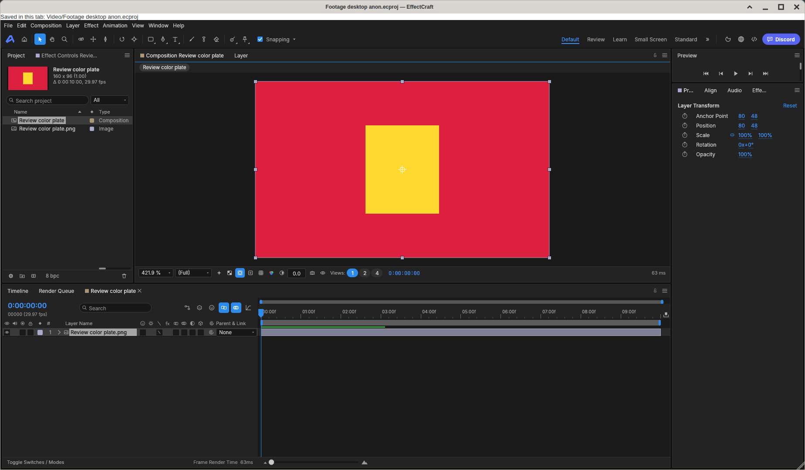

# EffectCraft

Create and save an editable composition from a small color plate, retaining the linked original in account storage.

| Viewport | Input | Result | Screenshot |
|---|---|---|---|
| 390 × 844 | Emulated touch and keyboard | Imported the PNG, dragged it into Composition and saved the one-layer project. The Composition panel was a narrow strip and the preview was effectively unusable. | [Phone](phone.png) |
| 820 × 1,180 | Emulated touch and keyboard | Created and saved the same one-layer composition. The viewer and time ruler were crowded by the docked panels. | [Tablet](tablet.png) |
| 1,920 × 1,080 | Mouse and keyboard | Reopened the exact phone file through Files, verified the rendered colors, duplicated its layer and saved a separate two-layer copy. | [1080p](desktop.png) |
| 3,840 × 2,160 | Mouse and keyboard | Created, rendered and saved the one-layer composition in the maximized window. | [4K](4k.png) |

In the original review, **New Composition From Footage** imported the PNG but left Composition empty at every size. Dragging the Project item into the empty Composition panel created the editable layer. The saved document and its linked original were read back from the server. The desktop copy retained the same original digest and left the phone file byte for byte intact. Physical touch, visible compact Save controls and usable compact composition playback remain open.

Tested in Chromium with disposable accounts on ksu.codes release `0234bfd516a2da8f4b78462518613c346c8027bf2689b04ee7a752d48726ae4b`.

## Composition from footage

On the original build, the WebOS browser picker accepted the PNG and saved it in Files, then issued an ordinary import. The saved project contained one media item and no active composition. The updated browser picker returns the stored paths to the native command that opened it. A separate test of ordinary Import still produced one media item.

Starting in **Animation & Video → EffectCraft**, select **New Composition From Footage** and choose an image. The project opens a composition with that image on its timeline. In the deployed verification, the selected 160 × 96 PNG created a composition of the same size with one editable layer. Its preview showed both source colors on desktop. Saving the project, opening it from **Files → Video** and saving a copy preserved the native project and linked original byte for byte.

| Deployed workflow | Result |
|---|---|
| Anon in browser-local Files at 390 × 844, 820 × 1180, 1920 × 1080 and 3840 × 2160 | Passed save, reopen and save-copy in all four viewports. No private Files requests originated in the anonymous session. |
| Signed-in desktop | Passed the same workflow, including signing into a fresh browser context and reopening the project from account Files. |
| Picker cancellation and ordinary import | A cancelled picker left the blank project clean. Ordinary Import added the selected asset to the Project panel. |

Live viewer `599df9e1187c2ca7e48419dca93dde71569b090d959c9db244b72d035909f64c`. [EffectCraft component commit](https://github.com/CC-David-CC/effectcraft/commit/c2a60018157fb1e3168309956df9caa04d49d48a) · [WebOS integration commit](https://github.com/CC-David-CC/WebOS/commit/0e75a28663edf75b6fee05702809360a5dcec3db).

WebOS main still records EffectCraft `fe1b82bacdc2cee15558b6658c647214c99dca90` at parent `3f541eb6e5561a56ed57a5a393088253d670c42f`. The verified fix is published on the two release branches linked above.

The compact panel follow-up is documented below.

## Compact composition and timeline

The previous phone layout placed the project and properties panes beside the viewer. The timeline reserved at least 420 logical points for its layer outline. The editor in the phone review was only 336 points wide. [Previous phone layout](compact-before.png)

In a narrow editor, **Viewer** and **Project** switch the upper pane. **Play** becomes **Stop** during playback. **Save** opens the normal Files picker. The timeline stays below the upper pane so you can tap the ruler and drag a layer while watching the composition. A wider editor retains its docked panels and their desktop preferences.

| Production workflow | Result |
|---|---|
| Anonymous phone, 390 × 844 | The 336-point editor displayed a 284 × 170 two-color composition. Taps moved the playhead. Playback advanced the timecode. A finger drag moved the layer and changed its saved start and in point. [Phone](compact-phone.png) |
| Anonymous tablet, 820 × 1180 | The 766-point editor displayed a 714 × 428 composition. The same touch and editable Files workflow passed. [Tablet](compact-tablet.png) |
| Signed-in phone | Tapped Save, signed into a fresh browser context and opened the edited native project from account Files. The copied project preserved the changed layer timing and original image. |
| 1920 × 1080 and 3840 × 2160 | The docked desktop workflow created a composition from footage, rendered both test colors and saved and reopened the linked project. Both roles passed at 1080p. Anon also passed at 4K. [Desktop](compact-desktop.png) · [4K](compact-4k.png) |

Each replay used **Animation & Video → EffectCraft** and **Files → Video**. The saved native project, its reopened copy and the content-addressed original were read independently. Anonymous sessions made zero requests to the private Files endpoints. Touch here was Chromium device emulation. Physical phone and tablet input and playback smoothness remain open.

The native UI library passed 603 tests, with four existing ignores. The existing composition-from-footage integration regression also passed.

The normal WebOS viewer build used the optimized component package at [EffectCraft 5dd98eceb02b](https://github.com/CC-David-CC/effectcraft/commit/5dd98eceb02b0c2557a4cbcf850342986799a0ca). The deployed viewer SHA-256 was `f79d3103b263ec47db06e7987b758212dc1761736e5ddd0f00c516d11f80444e`. [WebOS integration c091f2fedbe0](https://github.com/CC-David-CC/WebOS/commit/c091f2fedbe09422b5a3069afa840c17639be158)
