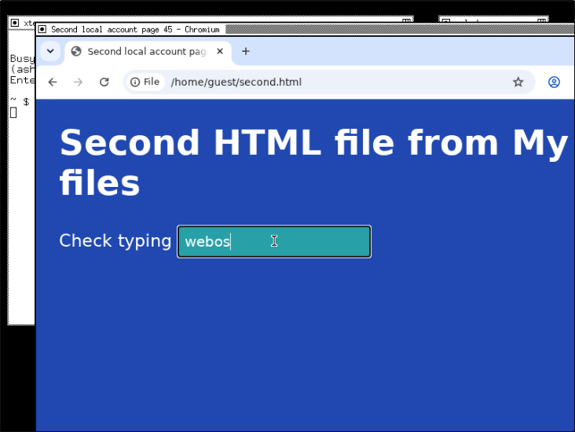

# Linux X11

Launch Programming → Linux X11, check xclock, and use xterm to write a file to the account home.

| Viewport | Input | Guest display | Screenshot |
|---|---|---|---|
| 390 × 844 | Emulated tap and keyboard | 336 × 252 CSS pixels. Both guest windows fit, with small terminal text. | [Phone](phone.png) |
| 820 × 1,180 | Emulated tap and keyboard | 766 × 575 CSS pixels. Both guest windows fit. | [Tablet](tablet.png) |
| 1,920 × 1,080 | Mouse and keyboard | 800 × 600 CSS pixels. | [1080p](desktop.png) |
| 3,840 × 2,160 | Mouse and keyboard | 800 × 600 CSS pixels, centered in the larger window. | [4K](4k.png) |

The signed guest reached xterm and xclock after about 68 seconds. Resizing the open window kept the shell session. At each size a pointer or emulated tap focused xterm and a typed command saved a separate file. After closing X11, a fresh Chromium desktop context signed into the same disposable account and verified the exact bytes of all four files. Chromium reported zero page errors.

Physical touchscreen input, the phone software keyboard, cold boot on mobile hardware, and viewport adjustments for readability remain open. See the [fix queue](../FIX-QUEUE.md).

Tested in Chromium on ksu.codes release `0234bfd516a2da8f4b78462518613c346c8027bf2689b04ee7a752d48726ae4b`.

## Chromium and local Files

On hosted release `efd370e5c981`, both roles opened local HTML from the guest home, followed a link to a second file, ran JavaScript and entered text. A fresh signed session read the saved files. Anon's open file survived registration, and normal X11 close flushed an open file. Both guests had loopback only.

| Time measured | Anon | Signed in |
|---|---:|---:|
| Start X11 to guest desktop | 67.69 s | 55.66 s |
| Launch guest Chromium to first visible page | 198.99 s | 162.08 s |
| Follow local link to second visible page | 26.41 s | 32.30 s |

The screenshot shows the focused-input run. A separate signed test on that release lost the first character when typing started immediately after clicking. On a physical device, open Programming → Linux X11, open a local HTML form in guest Chromium, then tap or click an empty field and immediately type `webos`. Record the visible text and whether the on-screen keyboard appeared on a touch device.

The subsequent ACAD viewer `b07393596a72` retained X11 bundle `04a6f9ff19fb4798802821670372d886eb7ac6f98acd328dde04f0e64eb4f80f`. Its X11 source is published on the WebOS release branch. The WebOS main tree had no `apps/linux-x11` gitlink when checked. [WebOS X11 release](https://github.com/CC-David-CC/WebOS/commit/aa941e2c5758d5b7b6980037444772129ded75e3) · [X11 source](https://github.com/CC-David-CC/linux-x11/commit/9f99166fabedf4d991a5a1f752d3613f903ed477)

## Immediate typing after a click

The X11 input controller fix passed on live viewer `5c2abc3689a1`. Both roles passed eight immediate click-and-type trials and read back a file written by the guest. The remaining hardware checks cover cold mobile startup and real keyboards. [Hosted workflow, screenshots and test page](chromium-input.md)
