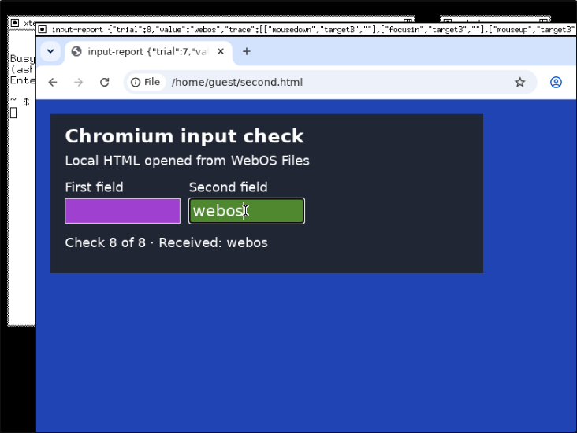

# Chromium click-and-type and local Files

On ksu.codes, the X11 guest received all five letters of `webos` in the field just clicked, on all eight attempts in each account mode. The previous release sent the first key to the page or the previously focused field in five of eight trials. The v86 input controller now delivers mouse and keyboard bytes in the order they arrived.

| Hosted result | Anon | Signed in |
| --- | ---: | ---: |
| X11 desktop ready | 63 s | 63 s |
| Guest Chromium first painted local HTML, from Chromium launch | 249 s | 250 s |
| Following a link to another local page | 40 s | 36 s |
| Immediate click and typing, alternating fields | 8/8 | 8/8 |

The tests uploaded local HTML through **Files**, launched **Programming → Linux X11**, opened it in guest Chromium, and clicked through to a second file with JavaScript. A WebOS browser keyboard sent each click followed immediately by five keys, with 140, 60, 15, or 0 ms between letters. Assertions checked the destination of every key and the complete text. Both roles downloaded a guest-written file through Files and verified the contents. Anon kept its workspace in the browser and promoted an open file on registration. A fresh signed-in browser session read and downloaded the saved result. Both guest network tables had no default route.

The signed-in run exercised the same page on the account Files mount. [Signed-in screenshot](chromium-input-signed.png) · [Release and test results](chromium-input-release.json)

The deployed viewer is `5c2abc3689a1c3247ef50af2b58e6aa8e01effede74dde70c26c78c36dfc5751`. The assembly release pins X11 at `a5c45148` and v86 at `9019aa65`. As checked at release, WebOS main at `3f541eb6` pinned v86 at `0ce2e875` and had no Linux X11 submodule entry. [Assembly release](https://github.com/CC-David-CC/WebOS/commit/f2f6eca040f6974b80984b45ac2cd7c5ac7654fe) · [X11 app](https://github.com/CC-David-CC/linux-x11/commit/a5c4514899d4097a81dc7f0a785f3aaa1545e1f9) · [v86 engine](https://github.com/CC-David-CC/engine-v86/commit/9019aa65bf60578fb342830b36315e466d39fb51)

**Physical keyboard and touch check.** Save the two-field test page as `chromium-click-type.html` and upload it to Files at Home. Open Programming → Linux X11. In xterm, run `chromium file:///home/guest/chromium-click-type.html`. Click or tap the first field, type `webos` immediately, then repeat in the second field. Alternate until the eighth result. Each check should show “Received: webos.” Please record device, whether you used a physical or on-screen keyboard, and the time until the page appears on a cold start. [Two-field test page](chromium-click-type.html)
