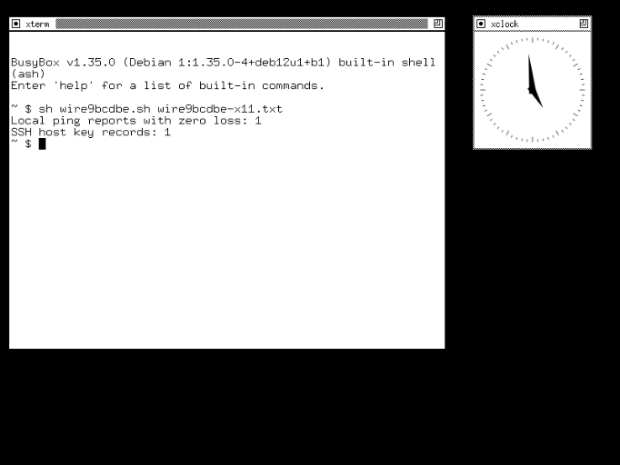

# Terminal and Linux X11 guest networking

On ksu.codes the Accounts service now has the handler for issuing short-lived guest network grants. The operator restarted this service once to install the handler. A fresh registered account signed in before the restart and renewed the same session afterward. Public issuer and configuration responses matched across the restart. The public relay returned HTTP 403 for a request without an admission cookie. Zero production grants were active during these checks.

The backend archive was built from WebOS `63541d0aa67a85fc26792603577675ee8a9d7643`. Its SHA-256 is `3067f69b84a92f871ebe3069b323bd08f8bb8693ab8fc2aaefc4531ba6e25f1f`. Its retained Accounts, Storage and Runtime packages matched the previous backend receipt before the scoped modules were added. The static desktop has a separate release and test record. [Chromium and Files](chromium-input.md)

In an isolated network namespace on the production host, the packaged handler admitted a temporary test subject and launched QEMU. Ordinary and anonymous sessions were denied. Revocation ended the connection and terminated QEMU in 1.028 seconds with 298 seconds left on the grant. The registered session could still renew. An earlier integration check reached the designated SSH server from both guests and verified its host key.

On the live site, Anon, an ordinary account and the temporary account before its grant each opened Terminal and Linux X11, pinged localhost and exchanged their test files through Files. All six launches had loopback only. With the temporary grant, both guests connected to the configured SSH server and matched its trusted Ed25519 host key. Revoking the grant closed both active WebSockets with more than 38 minutes left on the grant. The desktop session survived. A fresh sign-in of the same test account again opened both guests with zero relay connections and read back the two guest-written files.

The release branch pins the tested guest transport at WebOS `59fd86a94822`. A subsequent Calculator deployment retained the guest assets. Owner enablement, owner WAN testing and physical-device checks have separate release gates. [WebOS transport release](https://github.com/CC-David-CC/WebOS/commit/59fd86a94822690162e4eee12206d276acaf52ae)

