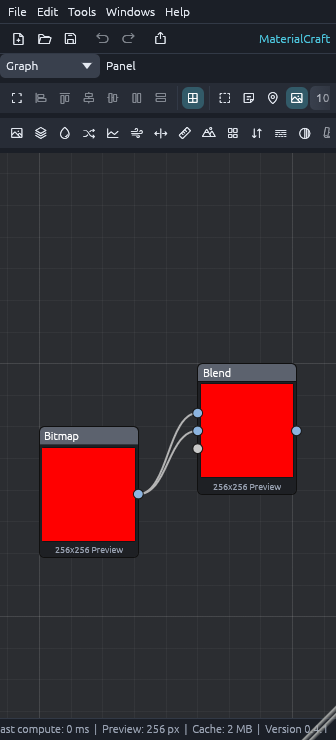
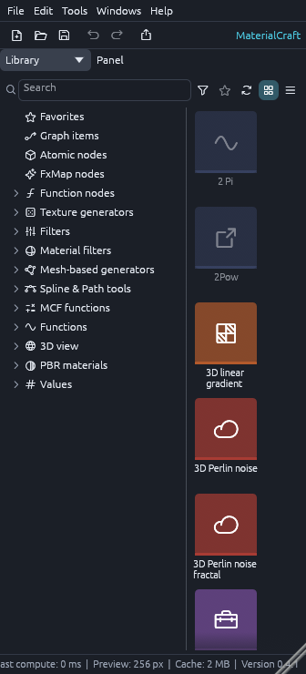
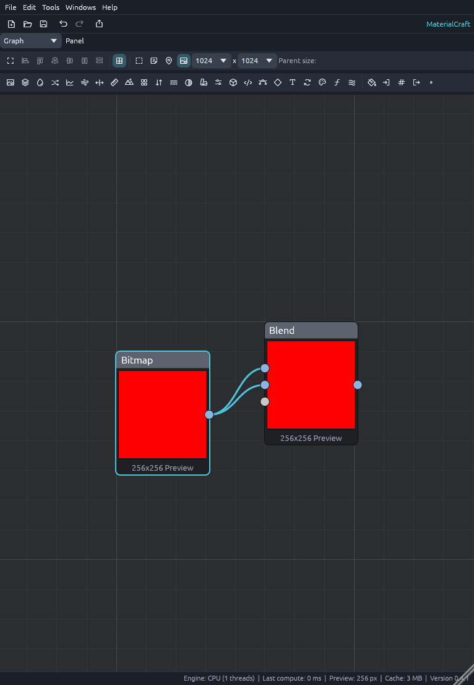
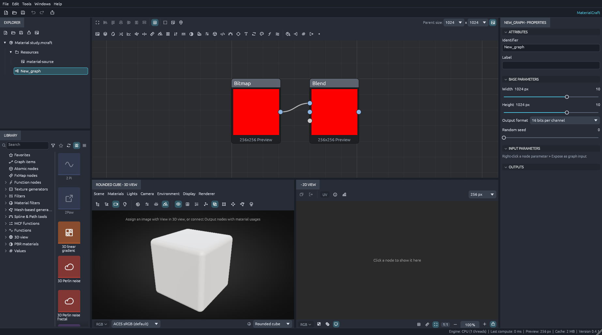

# MaterialCraft graph editing on compact screens

The graph now opens with the imported bitmap and its Blend node in view. On a narrow screen the panel selector opens the library, graph or preview individually. The desktop keeps its docked panels.

| Browser viewport | Account | Verified on ksu.codes |
|---|---|---|
| 390 × 844 | Anon and signed in | Imported a bitmap, added Blend, wired a second input and dragged the bitmap down. Reopening from Files restored both nodes, both connections and the original image. Switching to Library and back preserved the graph. |
| 820 × 1180 | Anon | The two nodes and ports fit on the tablet. Touch wiring, dragging, switching panels, saving and reopening passed. |
| 1920 × 1080 | Anon | Used the desktop docked graph to import, add Blend, save and reopen the editable project. |
| 3840 × 2160 | Signed in | Opened the saved native graph through Files in a fresh signed-in browser and verified its node positions and embedded bitmap. |

The phone test found a second bug. Starting a new drag after touching another card could include the distance between the two touches. Both phone account modes now save the bitmap at graph coordinates (50, 104) while the Blend node stays at (210, 40). The Anon runs made zero private file requests. Each signed-in project reopened in an independent browser session. A first 4K run exceeded the five-second wait for the window title to update. The repeat observed the saved title after 3.9 seconds and completed the independent reopen.

**Release.** The deployed viewer was `ca6f46cff1bae19ae5028cc69d2aab8242bd923e0e882107958324c57379a8c4`. All 25 public MaterialCraft files matched the candidate digests. WebOS release branch `release/materialcraft-anchored-graph` pins the app at `1f712a9504ea8d6ac1f313b5507130a7512c21d5`. At verification, WebOS main `3f541eb6` still pinned `b41e57dc`. [App source](https://github.com/CC-David-CC/materialcraft/commit/1f712a9504ea8d6ac1f313b5507130a7512c21d5) · [WebOS release](https://github.com/CC-David-CC/WebOS/commit/8af31adce2514703dc1c8c11adb0105d8fa36ddc)

The engine and UI suites passed with two test threads. The unrestricted run hit the existing cook-settling deadline in one UI test. That test passed on its own and in the complete two-thread run. The upstream-only drag patch passed 309 UI library tests with three ignored. [Upstream PR #307](https://github.com/storytold/materialcraft/pull/307)

**Hardware check still open.** On a phone or iPad, import a picture, add Blend, drag from the bitmap output to the second Blend input, then move the bitmap with a new touch. Save, reopen from Files and check that both wires and the new position are visible.
