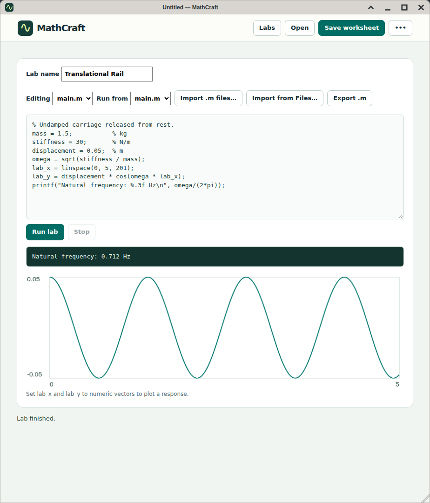

# MathCraft

Opened Programming → MathCraft in a fresh registered account, chose Translational Rail and ran its editable Octave program. The result was 0.712 Hz and the app plotted the displacement. The screenshot shows the actual worksheet.

Hosted bundle checks also exercised the library and custom code in Chromium touch emulation at 390×844 and 820×1180 and with mouse input at 1080p and 4K. A separate signed development check round-tripped an entry script and helper through Files. Physical iPad Safari and software-keyboard editing are pending.

Hosted release `860b318ddf2a03039ab8d9d27669e1fc0ef7f1a2c01a22e3af32dcf3a44da34f`.

