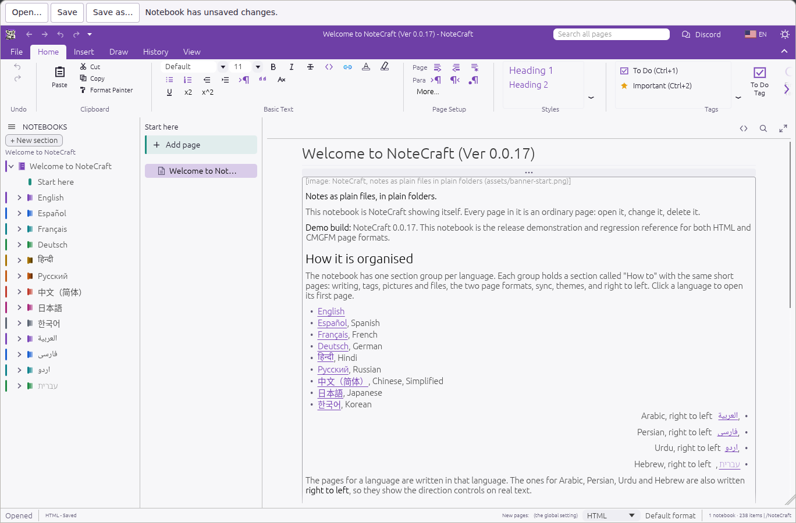

# NoteCraft

Open **Apps → Office → NoteCraft**. Write in a notebook, select **Save as**, then choose a folder in Files. Double-click the resulting `.notecraft` file to resume editing. It includes the notebook's native HTML, Markdown, attachments and settings.

| Check on ksu.codes | Result |
|---|---|
| Anon | Typed on a native page, saved to browser Files, reopened the document and added more text. Observed zero private file requests. |
| Account | Creating an account promoted the notebook. Another edit saved to the account, and a fresh signed-in browser reopened the byte-identical notebook through Files. |
| Fast typing | Reopened an existing page eight times. After clicking the text and pressing End, each string appeared immediately after the preceding one, including its first character. |
| Layout | Completed the native setup and saved the bundled Welcome notebook. The primary action was reachable at 390 × 844, 820 × 1180, 1920 × 1080 and 3840 × 2160. Phone and tablet used emulated touch. Physical touch and pen testing remain. |
| Source | The upstream Rust CI passed formatting, Clippy, native workspace and GUI tests, i18n, architecture, assets, docs, text and the demo check. WebOS archive tests passed. |

## Reproduce

1. Start an Anon session. Open NoteCraft from Office, finish setup and type on a notebook page. Save it in Documents, close the app and reopen the file from Files.
2. Click a previously saved line, press End immediately and type a new word. Save and reopen. Repeat on the same line and check that every word appears in order.
3. Register an account from the Anon session. Reopen the notebook, add another word and save. A fresh browser signed into that account should open the same edited page from Documents.

The app source checks used `node --test webos/tests/notebook.test.mjs` and `cargo xtask pre-push`. The release build used `webos/build-runtime.sh OUTPUT_DIRECTORY` followed by the parent `scripts/build_viewer.mjs` with the generated runtime as `--notecraft-site`. The production readback matched all 23 registered app payloads to their published SHA-256 digests.

The source-verified runtime in the deployed viewer was built from [NoteCraft 8a72dae68389](https://github.com/CC-David-CC/notecraft/tree/8a72dae6838966a21b7351804947d1d5aac53e05). The release uses [Desktop 797b7aaf41a3](https://github.com/CC-David-CC/desktop/tree/797b7aaf41a35300f115d8e66396e093ebb9f8c1) and [WebOS 39946fbda059](https://github.com/CC-David-CC/WebOS/tree/39946fbda059fb990b43b709e95df0f2be5111e4). The full viewer identifier is `7e6b2b35d462a5b4e1a6bd1467e69fd551398ebcfbf3516fbb1b3a3ae4df3b10`.

[Anon notebook](anon.png) · [Account notebook](member.png) · [Phone](phone.png) · [Tablet](tablet.png) · [Desktop](desktop.png) · [4K](4k.png) · [Verification data](production.json)
