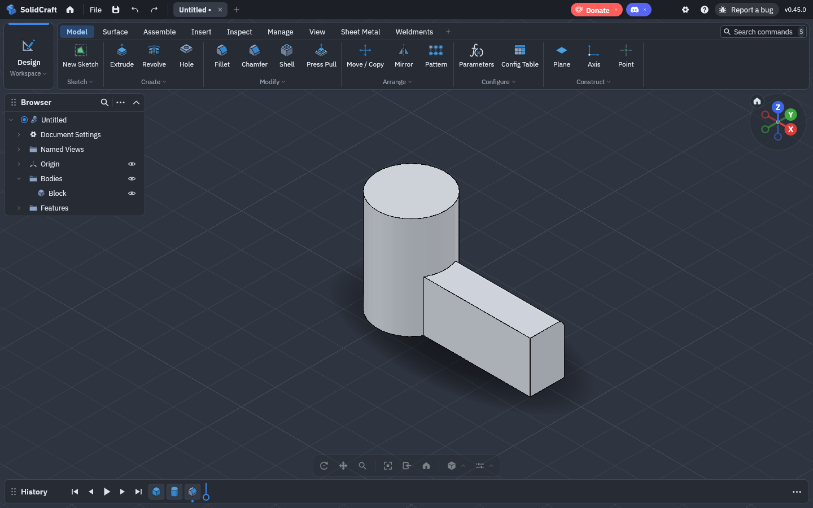

# SolidCraft

Open a native `.sc` design from account Files, apply a 2 mm edge fillet, and save the editable design.

| Viewport | Input | Result | Screenshot |
|---|---|---|---|
| 390 × 844 | Emulated touch and keyboard | Tapped the edge, confirmed the fillet, and saved through the visible toolbar. The model tree took most of the available canvas width. | [Phone](phone.png) |
| 820 × 1,180 | Emulated touch and keyboard | Tapped the edge and saved the added fillet. | [Tablet](tablet.png) |
| 1,920 × 1,080 | Mouse and keyboard | Reopened the exact phone revision from account Files. Rounded a second edge and saved a copy. The original phone revision kept the same SHA-256 digest. | [1080p](desktop.png) |
| 3,840 × 2,160 | Mouse and keyboard | Rounded an edge and saved the editable design. | [4K](4k.png) |

Every saved archive retained the original sketch and extrusion and recorded the new fillet with its selected edge and 2 mm radius. Chromium reported zero page errors. The automated test used the Fillet keyboard shortcut on all four viewports. Touch-only command access, precision selection, and viewport changes during an edit still need testing on physical devices. Curvature preview responsiveness is tracked separately in the [fix queue](../FIX-QUEUE.md).

Tested in Chromium with a disposable account on ksu.codes release `0234bfd516a2da8f4b78462518613c346c8027bf2689b04ee7a752d48726ae4b`.

## Standalone curvature fillet

On November 22, 2026, Chromium on ksu.codes ran a 2 mm curvature fillet on a block joined to a cylinder. The calculation took 4.34 s. During it the host accepted a click, the model zoomed in response to the mouse wheel, and the longest measured gap between page timer ticks was 160 ms. The same fixture on the previous engine held the page for 3.52 s. Timings are from one software-rendered browser run per build.

| Production check | Result |
|---|---|
| Native geometry | The before-and-after engine comparison produced the same closed solid with eight faces, 18 edges and 12 vertices. Surface area was 4,028.2220171301174 mm² and volume was 13,963.157561680615 mm³. |
| History and concurrent edits | Undo restored the original two features. Redo restored the fillet. A box requested during a fillet followed it in history. Switching documents while another fillet ran discarded the abandoned result. |
| Anon Files | Opened SolidCraft from CAD, drew a four-edge rectangle, saved the native project, closed the window, reopened it from Documents and saved an editable copy. The session made zero account-file requests. |
| Signed-in Files | Repeated the sketch and save, signed in from a fresh browser context, then reopened the file through Documents. The server returned the original bytes and the saved copy preserved all four edges. |

To reproduce the geometry, create a 40 × 10 × 15 mm block at (0, −5, 0), join a cylinder with radius 10 mm and height 30 mm at the origin, then call the standalone `solid.fillet` command with `{"edges":[[30,5,15]],"radius":2,"type":"curvature"}`. Scroll in the model viewport during the calculation. The separate phone check still requires a physical touchscreen to test the compact tree and reach Fillet by touch.

The exact browser build passed with both the WebOS and the fingerprinted module filenames. The native CI runner passed all 6,934 enabled tests across 27 binaries without retries. The suite skipped 27 tests. The tested WebOS viewer was `8f786851a88744a5e34bd325d541c747bca836c3fb3539549d323e0f6af80ba6`. Both pins were published on topic branches and awaited integration into their respective main branches at verification. [SolidCraft source](https://github.com/CC-David-CC/solidcraft/commit/789fce1bf17145b4086a175f552ce268c846f784) · [WebOS pin](https://github.com/CC-David-CC/WebOS/commit/343112d85e6ff3ec20e64e6bc63ad29e1e1d4fd7)
