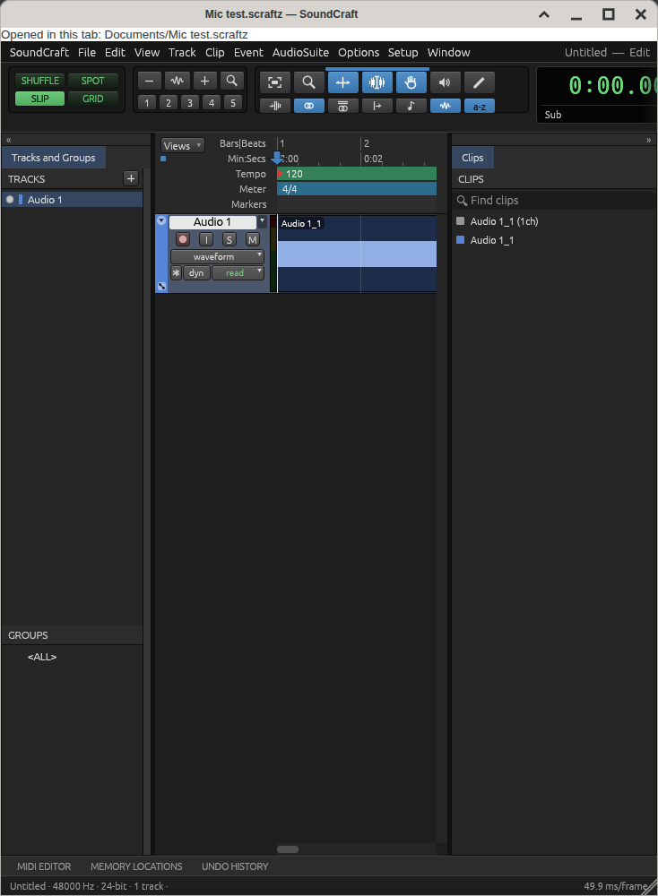

# SoundCraft

The released editor recorded a generated 440 Hz microphone through the Record button, saved the take in a native `.scraftz` project, and played it after reopening from Files. For the signed-in check, a separate browser context signed back into the disposable account. Anonymous Files stayed in the browser.

| Hosted Chromium check | Anon | Signed in |
|---|---:|---:|
| Recorded tone in project | 440 Hz | 440 Hz |
| Playback tone measured from WebAudio | 445.3 Hz | 433.6 Hz |
| Close until dirty-project prompt | 0.66 s | 0.63 s |
| Saved window close | 2.33 s | 2.29 s |
| Edited Close through Discard and removal | 4.08 s | 5.28 s |

Both roles retained the exact saved bytes after discarding a later edit. There were zero uncaught page errors. The test used software-rendered Chromium at 1540 × 1000 CSS pixels. A physical microphone and speaker or headphone check remains open, along with phone, tablet, 1080p and 4K task checks. The former software-rendering observation was 23.7 seconds through edited Discard on viewer `5c6cb58b0cd3`.

Viewer release `fdb8a0af8b45dc700baba6ee0205e112d299f1138bfbc90c2421ca2501981b2b`, SoundCraft `92ded9fdd09337864d219b49823efcbfb7659d98`, WebOS `a096a6aa16a8b82ea64d2523938bf0ee05a303a2`. [SoundCraft source](https://github.com/CC-David-CC/soundcraft/tree/92ded9fdd09337864d219b49823efcbfb7659d98) · [Reproducible browser check](https://github.com/CC-David-CC/WebOS/blob/a096a6aa16a8b82ea64d2523938bf0ee05a303a2/tests/soundcraft_microphone_browser.py)
