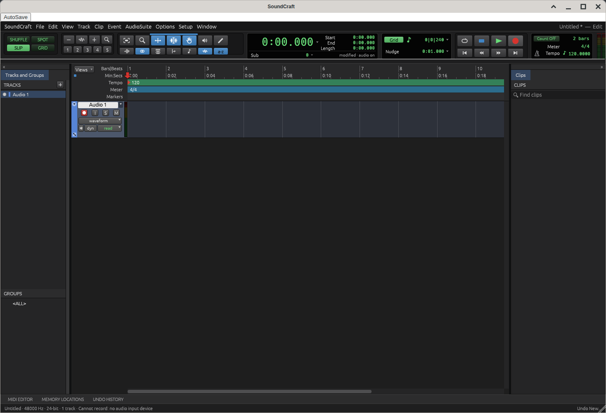

# SoundCraft

On ksu.codes, a signed-in disposable account opened Audio Tools → SoundCraft, created and armed one audio track, pressed Record, then closed the window and chose Discard. Chromium ran headless with software graphics at 1540 × 1000 CSS pixels. The screenshot shows the app window after pressing Record.

The editor reported “Cannot record: no audio input device.” It accepted Close and acknowledged both pause and finalization. The clean window closed in 2.1 seconds. The edited window took 23.7 seconds from the start of the automated Close click through Discard and removal. The window disappeared 0.15 seconds after the Discard click returned. The delay is reproducible under this test setup. Its cause remains open.

The exact package passed seven local account checks including playback, Save As and recovery. Microphone recording, phone, tablet, 1080p and 4K primary tasks and physical-device input still need testing.

Tested release `5c6cb58b0cd3528cd046b3b95b1763cd93284ce516d46605f652a1652d4d1bbd`, SoundCraft `dbc11ad16d32d36612f50d01f41d88ed3bd5aded`.
