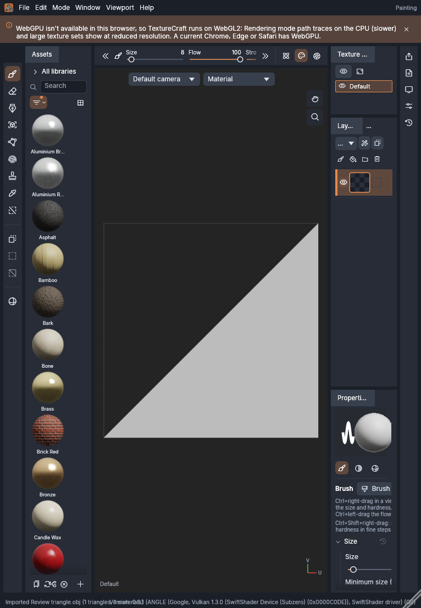
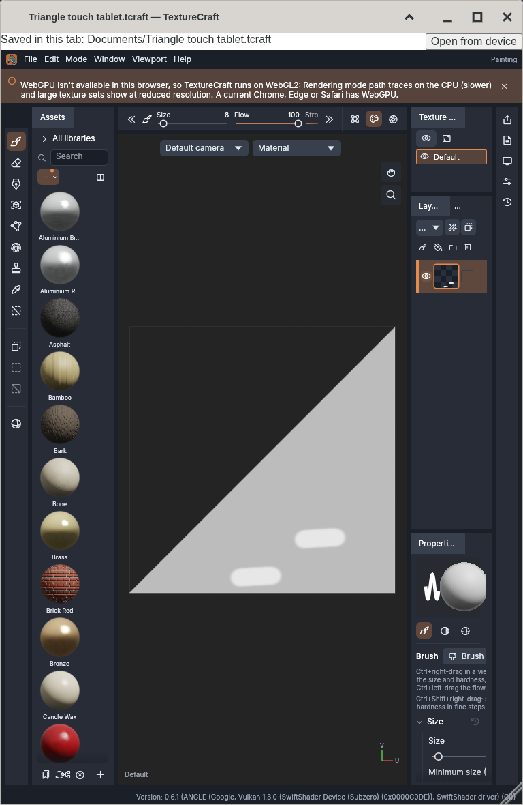

# Tablet brush contact

The original TextureCraft source tested on ksu.codes was `cd2c82345a8b0f1a0d4b8795b8e4bf7a08b8e479`. The browser reported WebGL2 software rendering for the emulated 820 × 1180 touchscreen.

1. Open TextureCraft under Materials & Textures and import a triangle OBJ with texture coordinates.
2. Select **Viewport → 2D view only**. Press inside the visible grey island, hold for about a second, draw a short line, and lift.
3. Choose **File → Save**. Reopen the resulting native `.tcraft` project through Files and inspect the paint layer.

The held stroke saved zero pixel entries. Both Anon and a disposable signed-in account also lost the first stroke in full-height windows under concurrent software rendering. In a shorter window, both roles saved five pixel channels and reopened the same mesh and paint bytes. A separate full-height Anon replay saved five channels and changed all five on a second edit after reopening. Browser event tracing delivered the full touch sequence to the focused canvas.

## Production verification

The repair starts the native UV brush when a finger makes contact and retains the stroke through a pause, movement and release. A second simultaneous touch cancels the brush gesture.

The native regression saved zero undoable strokes on the previous source and exactly one on the repaired source. All 258 default UI library tests passed serially on software Vulkan. The additional offscreen decal snapshot test passed when enabled separately.

The deployed menu → native OBJ import → 2D view → 1.45-second held-finger stroke → File → Save → Files reopen → edit and save workflow passed on the emulated tablet. The signed-in reopen used a new browser session. Anon made zero private file requests. The test inspected the allocated 64 × 64 tiles inside each native pixel channel, the pixel payload hashes and the embedded source mesh.

| Role | Pixel channels | Allocated tiles before reopening | Allocated tiles after second stroke | Files result |
|---|---:|---:|---:|---|
| Anon | 5 | 15 | 30 | Same bytes after reopening, revised after the second stroke. |
| Signed | 5 | 15 | 30 | Same bytes after reopening, revised after the second stroke. |

TextureCraft input [9ad00bf82201](https://github.com/CC-David-CC/texturecraft/commit/9ad00bf8220175ae203afb033fc34527a45f050e) shipped with [WebOS parent 03c6a2953b09](https://github.com/CC-David-CC/WebOS/commit/03c6a2953b0978e1f60d1ee98c186131d50799be) in viewer 2ea502c2e1c276f68d7b1d2f14c6b3ef5f78a6bcea63424e4991330f5dadded2. [Machine-readable production results](tablet-paint-results.json)

Physical finger, stylus pressure and real tablet GPU rendering remain to check.
