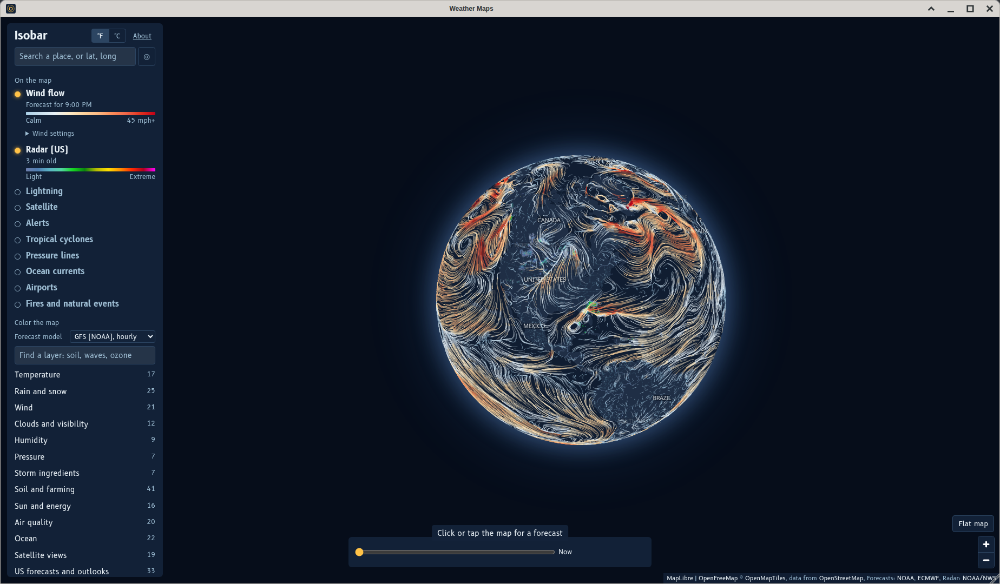

# Weather Maps

Opened Weather & Maps → Weather Maps, maximized the window, advanced the forecast from the keyboard and returned to Now. The screenshot shows the globe with wind and radar layers.

The original CSS let the layer panel intercept the range thumb at 768, 820 and 1024 CSS pixels. With the current hosted build, Chromium touch drags moved time and Now reset it at widths of 390, 568, 768, 820, 1024, 1180 and 1920. The layer menu was open. Physical iPad Safari remains unverified.

Hosted release `860b318ddf2a03039ab8d9d27669e1fc0ef7f1a2c01a22e3af32dcf3a44da34f`.

