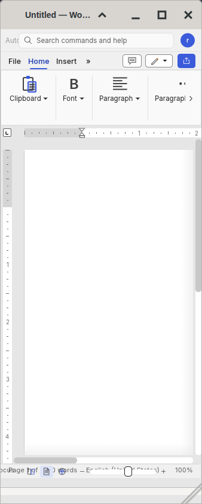

# WordCraft

A signed-in launch from Office opened the editor at a blank document. The desktop window showed the full ribbon. On a 390 × 844 CSS-pixel viewport the editing surface measured 336 × 794 after the desktop frame and apps bar. WordCraft collapsed parts of the ribbon into groups. The rightmost group, document width and status text still clipped, and some footer controls overlapped.

| View | Capture |
|---|---|
| Desktop |  |
| Phone |  |

Review status is partial. Opening and resizing were observed. Typing with the virtual keyboard, saving on a phone, reopening on desktop, PDF export and printing still need a signed-in cross-device test. Browser was Chromium. The desktop screenshot shows a tiled window in a 1920 × 1080 desktop. The phone screenshot uses emulated touch.
