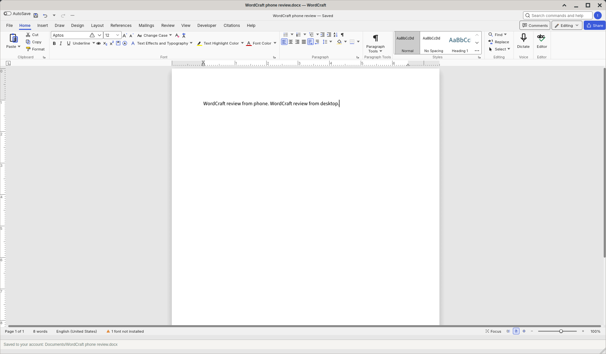

# WordCraft

A signed-in launch from Office opened the editor at a blank document. The desktop window showed the full ribbon. On a 390 × 844 CSS-pixel viewport the editing surface measured 336 × 794 after the desktop frame and apps bar. WordCraft collapsed parts of the ribbon into groups. The rightmost group, document width and status text still clipped, and some footer controls overlapped.

| View | Capture |
|---|---|
| Desktop |  |
| Phone |  |

Review status is partial. Opening and resizing were observed. Typing with the virtual keyboard, saving on a phone, reopening on desktop, PDF export and printing still need a signed-in cross-device test. Browser was Chromium. The desktop screenshot shows a tiled window in a 1920 × 1080 desktop. The phone screenshot uses emulated touch.

## Browser dictation

On November 21, 2026, a disposable account on ksu.codes dictated into CodeMirror, then into a selected word in WordCraft in the same Chromium tab. WebOS Voice Input transcribed a prerecorded speech fixture locally. The surrounding text stayed intact. Undo restored the selected word and Redo restored the transcript. Moving the caret during another recording discarded that recording. The filename field in Save As accepted dictation, and the saved DOCX reopened from account Files with the expected text. The microphone tracks ended and Chromium reported no page error. This run used an emulated microphone. Physical microphone and mobile keyboard behavior remain separate checks.

