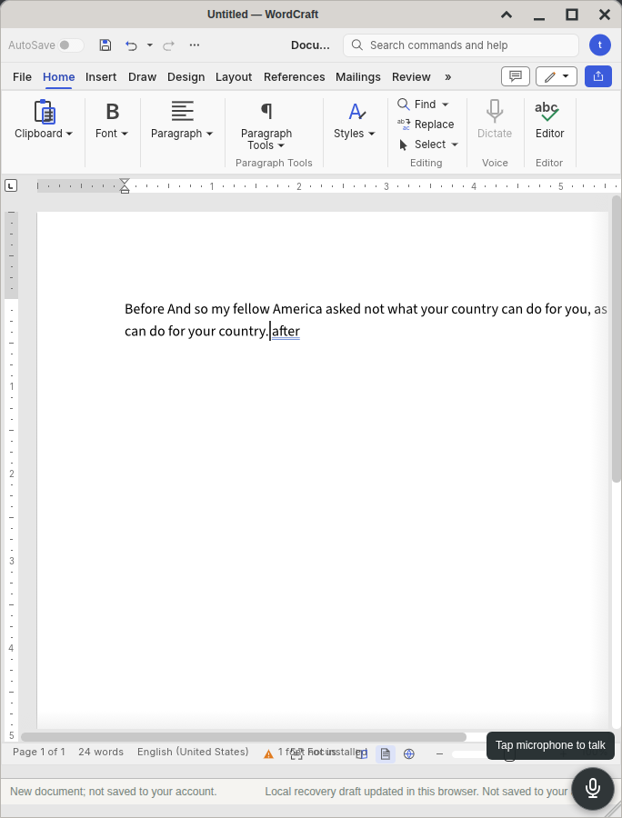

# WordCraft

On ksu.codes, open Office → WordCraft. At phone width the editor wraps text to the window and exposes File, Save and Tools. Tools includes common formatting commands and a paper-layout option. Wider windows keep the full ribbon. Print and export retain the document’s paper dimensions.

| Browser viewport | Production result | Screenshot |
|---|---|---|
| 390 × 844 touch | Tapped the native Save control twice and reopened the edited DOCX from Files. Anon used the same tab. Signed-in edits reopened in a fresh desktop browser. | [Phone](phone.png) |
| 820 × 1,180 touch | Full ribbon. Typed, saved and reopened the DOCX. | [Tablet](tablet.png) |
| 1,920 × 1,080 | Full ribbon. Typed, saved and reopened the DOCX. | [Desktop](desktop.png) |
| 3,840 × 2,160 | Full ribbon. Typed, saved and reopened the DOCX. | [4K](4k.png) |

The browser run used emulated touch and inserted text. A physical phone still needs a check with its on-screen keyboard and IME. Real printer output also remains open.

WebOS viewer `37726dc08098e42b1cee2b8a05977b4e5e6e7d03c819205276a8bcd3cef55707`. [WordCraft component ebe09b3c57bc](https://github.com/CC-David-CC/wordcraft/commit/ebe09b3c57bc4a834320d747cc4e25db3c6aeee1) · [WebOS release 6df090a71ac0](https://github.com/CC-David-CC/WebOS/commit/6df090a71ac07fe90e3ea1c58cfe94e05fa2e3ce)

The WebOS main branch still pinned WordCraft at `edeb4a090cd3` when this production release was verified.

## Browser dictation

On November 21, 2026, a disposable account on ksu.codes dictated into CodeMirror, then into a selected word in WordCraft in the same Chromium tab. WebOS Voice Input transcribed a prerecorded speech fixture locally. A mouse drag selected the word before the user opened System Tools → Voice input. That menu command started recording directly and the surrounding text stayed intact. Undo restored the selected word and Redo restored the transcript. Moving the caret during another recording discarded that recording. The filename field in Save As accepted dictation, and the saved DOCX reopened from account Files with the expected text. The microphone tracks ended and Chromium reported no page error. This run used an emulated microphone. Physical microphone and mobile keyboard behavior remain separate checks.

